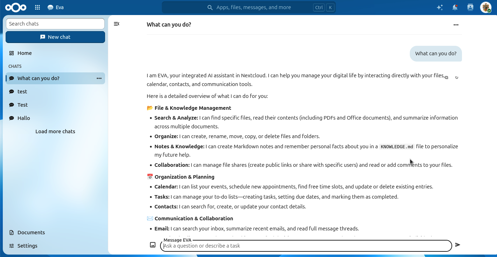
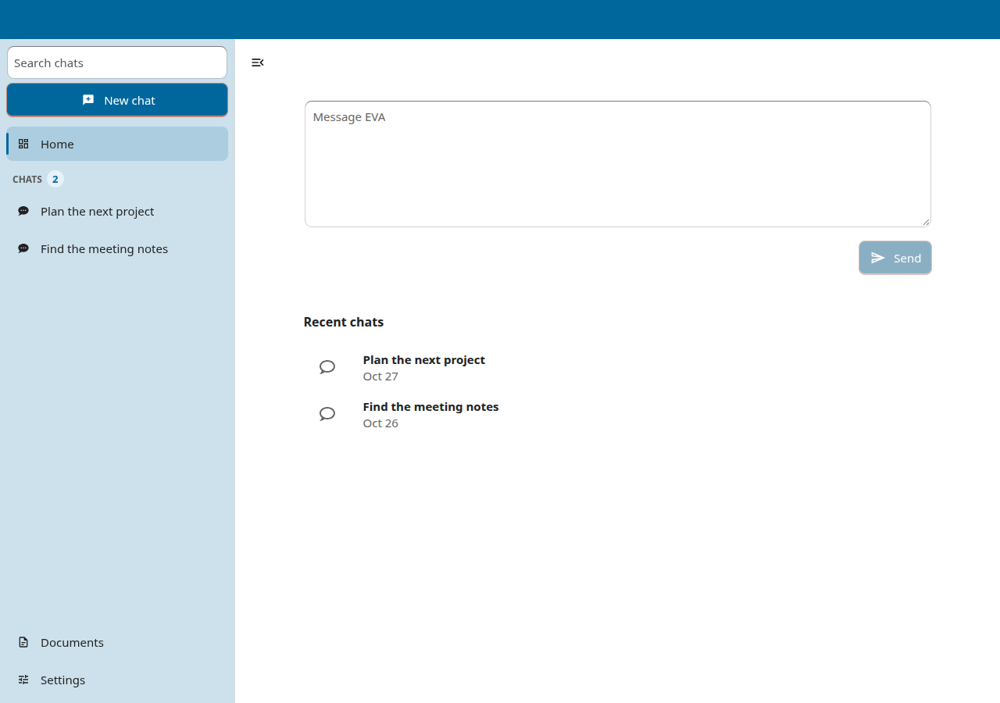
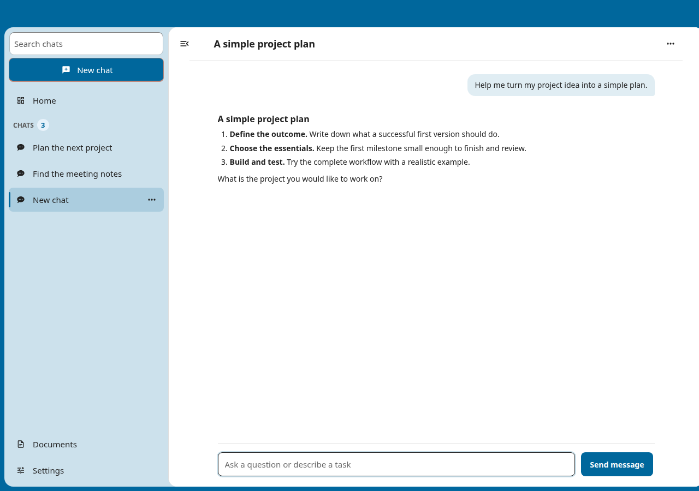
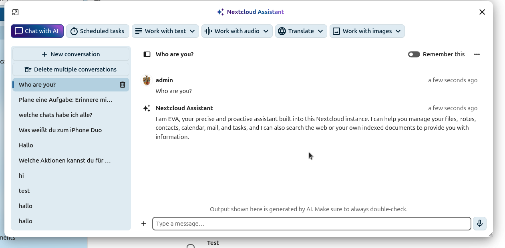
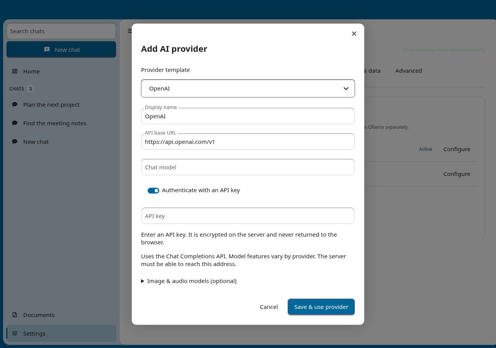
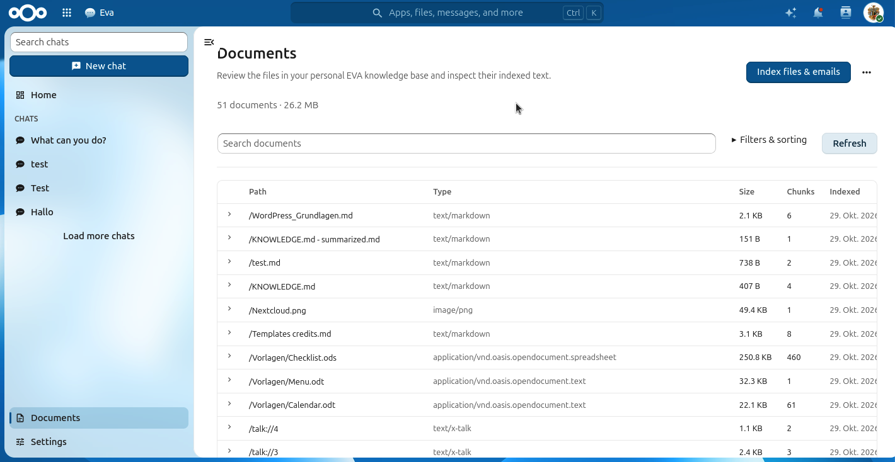
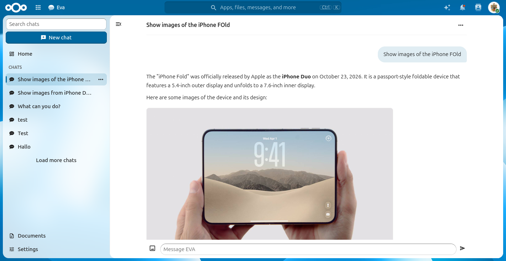

# EVA — Your AI workspace in Nextcloud

Ask questions, find information in your files and work through everyday tasks
without leaving Nextcloud. EVA brings conversations, cited document answers and
Nextcloud tools into one workspace. It is built deeply into Nextcloud: it runs
as a native app, powers the Nextcloud Assistant across the whole instance, and
talks to Files, Mail, Calendar, Contacts, Tasks, Shares and Talk through their
real APIs — with more than 80 built-in actions.

[](https://github.com/SchBenedikt/nextcloud-ai/actions/workflows/tests.yml)
[](LICENSE)
[](appinfo/info.xml)

[Install EVA](https://apps.nextcloud.com/apps/eva_ai) ·
[Get started](docs/QUICKSTART.md) · [Documentation](docs/README.md) ·
[Report a problem](https://github.com/SchBenedikt/nextcloud-ai/issues)

## Start with a conversation

Home gives you a message input and recent conversations. The chat header stays
compact; exports, reusable prompts and conversation settings live in the native
Nextcloud action menu. Documents and settings each have a clear place in the
navigation.

Settings are grouped into Models, Documents, Tools & permissions, Automation,
Personal & data, and Advanced. Optional integrations load when you open their
section, keeping the everyday path focused.

EVA can also tell you what it can do: ask "What can you do?" and it lists its
file, calendar, task, contact, mail and communication actions for your setup.







## Deep Nextcloud integration and the Nextcloud Assistant

EVA is not an external chatbot next to Nextcloud — it is woven into it:

- **Nextcloud Assistant**: EVA registers native TaskProcessing providers, so it
  powers the official Nextcloud Assistant app. Chat with your indexed files
  directly in the Assistant sidebar, use EVA for text work (translate, summarize,
  proofread, formalize, reformulate, headlines, topics, emoji), audio
  (transcription, subtitles, text-to-speech, audio chat) and images (OCR, image
  analysis, text-to-image). Scheduled tasks ("Geplante Aufgaben") can trigger
  EVA, and the Assistant can propose file, calendar, mail and task actions that
  you confirm before anything runs.
- **Files**: open with EVA from the file menu for a focused file conversation,
  index documents, mails and Talk conversations, and let EVA create, move,
  rename, share or comment on files.
- **Talk**: add EVA as a bot to a Talk conversation, or let EVA read and post
  messages in rooms on your behalf (off by default, enabled per user).
- **Search**: EVA appears in the unified Nextcloud search for your indexed
  content.
- **Admin**: native admin settings, OpenMetrics exporters and OCC commands fit
  into standard Nextcloud operations.



## Choose your AI provider

Use native Ollama or Groq, or add compatible profiles for OpenAI, Google Gemini,
Mistral, DeepSeek, OpenRouter, Together AI, xAI, LM Studio, vLLM and other servers
implementing Chat Completions. Configure profiles in a form with a name, API
address, model and encrypted key. No JSON editing is needed.

Profiles have separate keys and support multiple configurations of the same
service. Local servers can explicitly disable key authentication. Available
models, tool support and image/audio capabilities depend on the provider.
See the [provider guide](docs/PROVIDERS.md).



Previews show the workspace components with synthetic conversation data in a
test shell using Nextcloud core styles. They do not contain private account data.

Automatic file-search generations use Ollama by default, independently of the
chat provider. A compatible profile can optionally configure its own embedding
model and dimensions; selecting it sends indexed file text to that endpoint.
Review the provider and model before assuming inference stays on your own
infrastructure. See [generation embeddings](docs/GENERATION-EMBEDDINGS.md).

## Ask about your documents

EVA extracts supported text, PDF, Office, OpenDocument and other file formats,
then combines semantic and keyword retrieval. File answers can link to their
sources so you can verify the response. Optional extraction utilities are
needed for some formats; see [Features](docs/FEATURES.md).

Use Documents to inspect the index and extracted text — with search, filters and
the extracted chunk text per file — or choose **Open with EVA** from Files for a
focused file conversation. Background indexing continues when you leave the
page. Progress checks use a lightweight endpoint without model discovery or
system diagnostics.



## More than 80 actions across Nextcloud

EVA works with the real Nextcloud services through their APIs. Every write
action asks for your confirmation before it runs. Highlights:

- **Files & knowledge**: search, read, create, rename, move, copy, checksum and
delete files, create Markdown notes, keep a KNOWLEDGE.md memory, manage shares
(public links or users), comments, system tags and file versions.
- **Calendar**: list calendars and events, create, update and delete events, and
find free slots for a meeting.
- **Mail**: search, list and read mails, count unread messages and summarize your
inbox (mails are also indexable for semantic search).
- **Tasks & Contacts**: create, update, complete and delete tasks; search,
create, update and delete contacts, and manage your own profile.
- **Talk**: list rooms, read chats and post messages into Nextcloud Talk.
- **Web search & images**: search the web for current information and show
images from the internet directly in the chat, with the source page always
cited.
- **Briefings & scheduling**: scheduled briefings and Nextcloud Assistant
scheduled tasks, plus recent activity and weather on request.
- **Extensibility**: terminal commands, generic Nextcloud App API calls and
external connectors for services beyond Nextcloud.

Web search, image search and external connectors have separate data flows —
review permissions and privacy switches before enabling them.



Scheduled briefings, usage metrics, background runs, extensions and scoped API
keys remain available through the relevant settings sections. Export chats as
Markdown, text, HTML or DOCX, print to PDF, or create a batch archive. A compatible
provider can also generate images into your EVA folder in Files.

## Install and configure

Install from the [Nextcloud App Store](https://apps.nextcloud.com/apps/eva_ai),
then follow the [quick start](docs/QUICKSTART.md). Supported Nextcloud versions
are declared in [appinfo/info.xml](appinfo/info.xml).

For a source installation, use Node.js from [.nvmrc](.nvmrc), PHP 8.2+ and Composer:

```bash
composer install --no-dev --prefer-dist
npm ci
npm run build
```

Enable the app in Nextcloud and configure working cron before background jobs.
Deploy the complete built `js/` directory: lazy sections need their chunks too.

## Data and privacy

The index is stored on the Nextcloud server. Indexing sends extracted content
to the configured embedding endpoint. Chat sends prompts, relevant excerpts,
conversation context and tool results to the selected provider. Cloud services,
web search and connectors can send information outside your server.
Built-in SQL is the default search index. Optional Qdrant dense search keeps
chunk text in SQL; native Qdrant BM25 is a separate per-generation opt-in that
stores chunk text remotely and sends search queries to that Qdrant service. See
the [Qdrant privacy and setup notes](docs/QDRANT.md) before enabling it.
An optional, loopback-only Docker Compose deployment is included for
self-hosted Qdrant; installing EVA alone still uses SQL.

API keys are encrypted separately per user and are never returned by the
profile form. Answers can contain mistakes; check sources and review actions.
Read [Privacy](docs/PRIVACY.md), [Security](docs/SECURITY.md) and
[Configuration](docs/CONFIGURATION.md) before enabling integrations.

## Documentation and development

- [User guide](docs/USER-GUIDE.md) and [workspace settings](docs/WORKSPACE.md).
- [Provider setup](docs/PROVIDERS.md) and [troubleshooting](docs/TROUBLESHOOTING.md).
- [Architecture](docs/ARCHITECTURE.md), [performance](docs/PERFORMANCE.md) and
  [workspace migration](docs/WORKSPACE-MIGRATION.md).
- [Encrypted chat storage migration](docs/CHAT-STORAGE-MIGRATION.md): resumable SQL import and recovery; AppData remains authoritative until the later cutover.
- [API reference](docs/API.md), [plugins](docs/PLUGIN_API.md) and [connectors](docs/CONNECTORS.md).
- [Generation embeddings](docs/GENERATION-EMBEDDINGS.md): Ollama default, explicit compatible-profile opt-in, native administrator model/space checks; SQL remains the installation default.
- [Background generation builds](docs/GENERATION-BUILDS.md): explicit source processing, progress and pause/resume; search activation still requires full verification.
- [Contributing](CONTRIBUTING.md), [development](docs/DEVELOPMENT.md) and [CI](docs/CI.md).

```bash
composer test
npm test
npm run lint
npm run test:browser
npm run build
```

Frontend changes must include regenerated `js/` output. Submit changes through
pull requests. The standalone chat remains a compatibility and test surface;
the Nextcloud workspace is the primary interface.

Licensed under [AGPL-3.0-or-later](LICENSE).

### A native Nextcloud workspace

The home screen stays focused on a large message field and recent chats using
Nextcloud's own list components. Settings use native sections and sidebar navigation, with
AI providers, document search and advanced integrations kept in separate areas.
See [Workspace settings](docs/WORKSPACE.md) for navigation and saving behavior.
