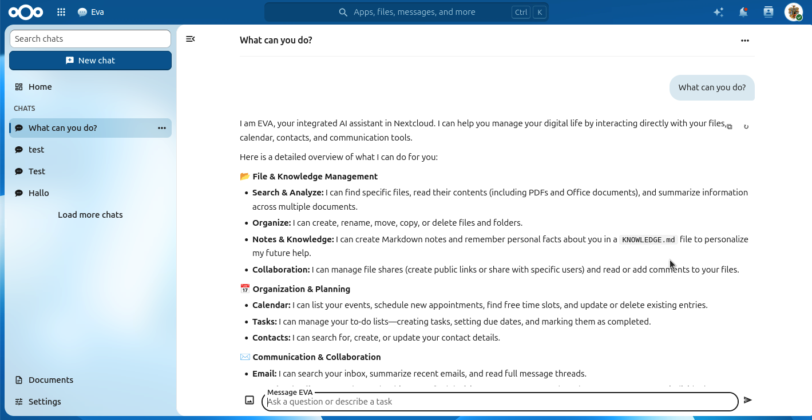
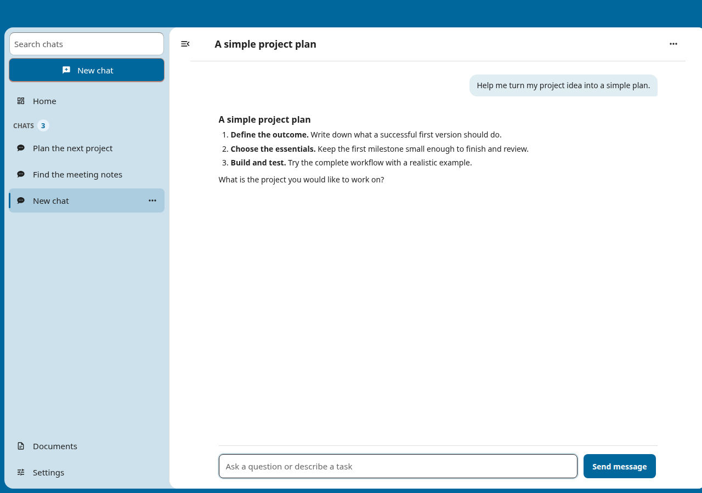
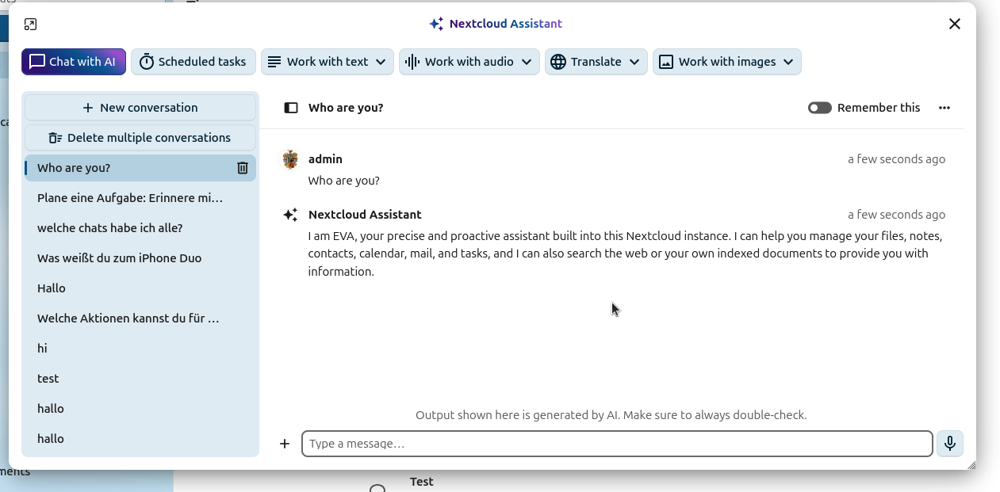
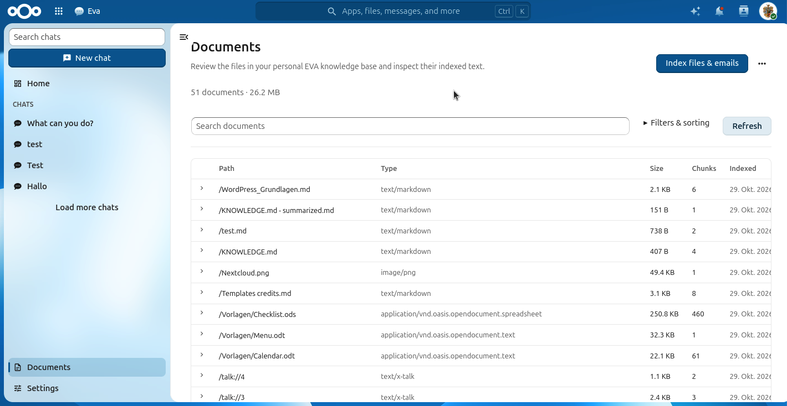
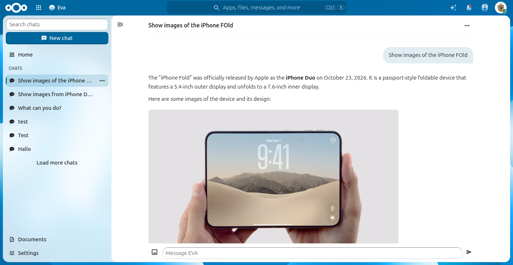

# EVA — Your AI assistant for Nextcloud

**Ask questions about your files. Get answers with sources. Take action across
Nextcloud when you approve it.** EVA brings AI into the workspace you already
use, including the official Nextcloud Assistant, Files, Mail, Calendar,
Contacts, Tasks, Shares and Talk.

Keep document search on Nextcloud's built-in SQL index, connect local or hosted
models, and enable only the integrations you need. A separate vector database
is optional.

[](https://github.com/SchBenedikt/nextcloud-ai/actions/workflows/tests.yml)
[](LICENSE)
[](appinfo/info.xml)

[Install EVA](https://apps.nextcloud.com/apps/eva_ai) ·
[Try the quick start](docs/QUICKSTART.md) · [Documentation](docs/README.md) ·
[Report a problem](https://github.com/SchBenedikt/nextcloud-ai/issues)

## Get useful answers from your own Nextcloud

EVA helps people and teams find information and get routine work done without
copying content into a separate chatbot. Ask a general question, find a fact in
an indexed document, or prepare a change to review. File answers include the
sources EVA used. AI-proposed changes to Nextcloud data require your confirmation
before they run.

### Start in three steps

1. **Install EVA** from the Nextcloud App Store and enable it.
2. **Choose a chat model** in **EVA → Settings → Models**. The default is
   `gemma4:cloud` through Ollama Cloud. To keep chat inference on your own
   infrastructure, choose a model installed on your local Ollama server.
3. **Ask a question**, then index a small Files folder and ask something you
   can verify in the cited source. Add Mail, Talk, web search or write actions
   only when you need them.

### Work where your files and conversations already are

- Ask questions about indexed Files, Mail and opted-in Talk conversations; open
  a file directly with EVA for a focused answer.
- Use the official Nextcloud Assistant with EVA's native task providers for
  chat, writing, translation, audio and image tasks.
- Search and work with Calendar, Contacts, Tasks, Shares and Talk through
  Nextcloud services.
- Review AI-proposed changes and confirm them before EVA carries them out.

The home screen keeps recent chats close by. Settings are grouped into Models,
Documents, Tools & permissions, Automation, Personal & data, and Advanced.
Optional integrations load when you open their section.

Ask EVA **“What can you do?”** to see which actions are available in your
Nextcloud setup.






## Deep Nextcloud integration and the Nextcloud Assistant

EVA is not an external chatbot next to Nextcloud — it is woven into it:

- **Nextcloud Assistant**: EVA registers native TaskProcessing providers for
  the official Assistant app. An administrator selects **Eva · ...** as the
  preferred provider for each desired task type in **Administration → AI →
  Unified task processing**. Once selected, users can chat with indexed files
  directly in the Assistant sidebar. On Nextcloud 35 and newer, EVA streams
  Context Agent, core RAG, and text or multimodal chat-with-tools replies into
  the Assistant as they are generated, including post-confirmation summaries.
  Ollama, Groq and OpenAI-compatible profiles stream live text when their
  endpoint supports streaming. Tool calls stay buffered until complete and
  continue to follow EVA's permission policy. Older supported versions keep
  the synchronous provider contract. Remembered
  conversations personalize replies, and the Assistant's chat-specific
  instructions apply to EVA agent conversations. Use EVA for text work
  (translate, summarize, proofread, formalize, reformulate, headlines, topics,
  emoji), audio
  (transcription, subtitles, text-to-speech, audio chat) and images (OCR, image
  analysis, text-to-image and stickers). Scheduled tasks
  can trigger EVA, and the Assistant can propose file, calendar, mail and task
  actions that you confirm before anything runs.
- **Files**: open with EVA from the file menu for a focused file conversation,
  index documents, mails and Talk conversations, and let EVA create, move,
  rename, share or comment on files.
- **Talk**: add EVA as a bot to a Talk conversation, or let EVA read and post
  messages in rooms on your behalf (off by default, enabled per user).
- **Search**: EVA appears in the unified Nextcloud search for your indexed
  content.
- **Admin**: native settings show which Assistant task types are enabled and
  routed to EVA, alongside OpenMetrics exporters and OCC commands for standard
  Nextcloud operations.



## Choose where AI runs

Use EVA's built-in Ollama and Groq integrations, or add compatible profiles for
OpenAI, Google Gemini, Mistral, DeepSeek, OpenRouter, Together AI, xAI, LM
Studio, vLLM and other servers implementing Chat Completions. Configure each
profile with a name, API address, model and encrypted key. No JSON editing is
needed.

Profiles have separate keys and support multiple configurations of the same
service. Local servers can explicitly disable key authentication. Available
models, tool support and image/audio capabilities depend on the provider.
See the [provider guide](docs/PROVIDERS.md).

Chat and document embeddings are configured separately. The default chat model
is `gemma4:cloud`, which sends chat requests to Ollama Cloud. The default
embedding endpoint is the configured Ollama server; indexing sends extracted
file text there. You can choose a local chat model and keep embeddings on the
local Ollama server, or explicitly route either workload to a compatible
hosted profile. Review both destinations before indexing sensitive content.


Previews show the workspace components with synthetic conversation data in a
test shell using Nextcloud core styles. They do not contain private account data.

Automatic file-search generations use the embedding destination independently
of the chat provider. A compatible profile can optionally configure its own
embedding model and dimensions; selecting it sends indexed file text to that
endpoint. See [generation embeddings](docs/GENERATION-EMBEDDINGS.md).

## Ask about your documents

EVA extracts supported text, PDF, Office, OpenDocument and other file formats,
then combines semantic and keyword retrieval. File answers can link to their
sources so you can verify the response. Optional extraction utilities are
needed for some formats; see [Features](docs/FEATURES.md).

Use Documents to inspect the index and extracted text — with search, filters and
the extracted text per file — or choose **Open with EVA** from Files for a
focused file conversation. Background indexing continues when you leave the
page.



## Everyday Nextcloud work, with your approval

EVA works with the real Nextcloud services through their APIs. Every write
action asks for your confirmation before it runs. Highlights:

- **Files & knowledge**: search, read, create, rename, move, copy, checksum and
delete files, create Markdown notes, keep a KNOWLEDGE.md memory, manage shares
(public links or users), comments, system tags and file versions.
- **Calendar**: list calendars and events, create, update and delete events, and
find free slots for a meeting.
- **Mail**: search, list and read mails, count unread messages and summarize your
inbox (mails are also indexable for semantic search).
- **Tasks & Contacts**: create, update, complete and delete tasks; search,
create, update and delete contacts, and manage your own profile.
- **Talk**: list rooms, read chats and post messages into Nextcloud Talk.
- **Web search & images**: search the web for current information and show
images from the internet directly in the chat, with the source page always
cited.
- **Briefings & scheduling**: scheduled briefings and Nextcloud Assistant
scheduled tasks, plus recent activity and weather on request.
- **Extensibility**: terminal commands, generic Nextcloud App API calls and
external connectors for services beyond Nextcloud.

Web search, image search and external connectors have separate data flows —
review permissions and privacy switches before enabling them.



Scheduled briefings, usage metrics, background runs, extensions and scoped API
keys remain available through the relevant settings sections. Export chats as
Markdown, text, HTML or DOCX, print to PDF, or create a batch archive. A compatible
provider can also generate and edit images in your EVA folder in Files. On
Nextcloud 36, image editing is available through TaskProcessing when the active
OpenAI-compatible provider supports image edits.

## Install and configure

Install from the [Nextcloud App Store](https://apps.nextcloud.com/apps/eva_ai),
then follow the [quick start](docs/QUICKSTART.md). EVA supports Nextcloud 30–36
and PHP 8.2 or newer; the [app manifest](appinfo/info.xml) is authoritative.

For a source installation, use Node.js from [.nvmrc](.nvmrc), PHP 8.2+ and Composer:

```bash
composer install --no-dev --prefer-dist
npm ci
npm run build
```

Enable the app in Nextcloud and configure working cron before background jobs.
Deploy the complete built `js/` directory: lazy sections need their chunks too.

## Data and privacy

The index is stored on the Nextcloud server. Indexing sends extracted content
to the configured embedding endpoint. Chat sends prompts, relevant excerpts,
conversation context and tool results to the selected provider. The default
chat model is hosted by Ollama Cloud; select a locally installed Ollama model
for local chat inference. Embeddings use the configured Ollama server by
default, but a compatible hosted profile can be selected separately. Web
search, image search and external connectors can send information outside your
server.
Built-in SQL is the default search index. Optional Qdrant dense search keeps
chunk text in SQL; native Qdrant BM25 is a separate per-generation opt-in that
stores chunk text remotely and sends search queries to that Qdrant service. See
the [Qdrant privacy and setup notes](docs/QDRANT.md) before enabling it.
An optional, loopback-only Docker Compose deployment is included for
self-hosted Qdrant; installing EVA alone still uses SQL.

API keys are encrypted separately per user and are never returned by the
profile form. Download an EVA data archive from **Personal & data** and restore
up to 500 chats later; restored conversations receive new IDs and never replace
existing chats. Restore imports chat text only, not the archive's knowledge,
index metadata, vector generations or provider configuration. Answers can
contain mistakes; check sources and review actions.
Read [Privacy](docs/PRIVACY.md), [Security](docs/SECURITY.md) and
[Configuration](docs/CONFIGURATION.md) before enabling integrations.

## Documentation and development

- [User guide](docs/USER-GUIDE.md) and [workspace settings](docs/WORKSPACE.md).
- [Provider setup](docs/PROVIDERS.md) and [troubleshooting](docs/TROUBLESHOOTING.md).
- [Architecture](docs/ARCHITECTURE.md), [performance](docs/PERFORMANCE.md) and
  [workspace migration](docs/WORKSPACE-MIGRATION.md).
- [Encrypted chat storage migration](docs/CHAT-STORAGE-MIGRATION.md): resumable SQL import and recovery; AppData remains authoritative until the later cutover.
- [API reference](docs/API.md), [plugins](docs/PLUGIN_API.md) and [connectors](docs/CONNECTORS.md).
- [Generation embeddings](docs/GENERATION-EMBEDDINGS.md): Ollama default, explicit compatible-profile opt-in, native administrator model/space checks; SQL remains the installation default.
- [Background generation builds](docs/GENERATION-BUILDS.md): explicit source processing, progress and pause/resume; search activation still requires full verification.
- [Contributing](CONTRIBUTING.md), [development](docs/DEVELOPMENT.md) and [CI](docs/CI.md).

```bash
composer test
npm test
npm run lint
npm run test:browser
npm run build
```

Frontend changes must include regenerated `js/` output. Submit changes through
pull requests. The standalone chat remains a compatibility and test surface;
the Nextcloud workspace is the primary interface.

Licensed under [AGPL-3.0-or-later](LICENSE).
