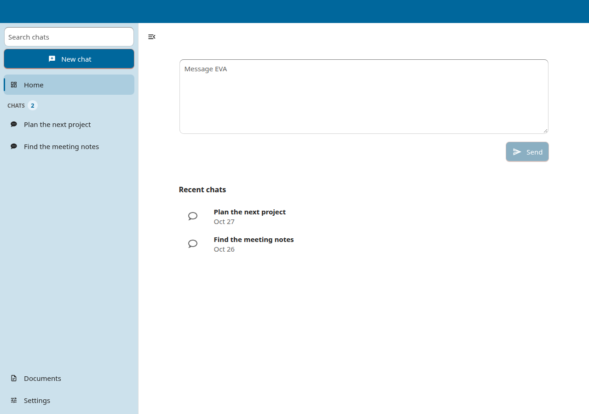
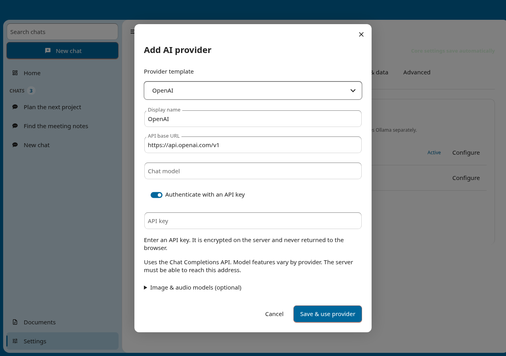

# EVA — AI that works inside Nextcloud

**Find answers in your files. Get help with everyday work. Keep every change
under your control.** EVA brings AI into the Nextcloud workspace you already
use, with cited document answers, native Assistant integration and tools for
Files, Mail, Calendar, Contacts, Tasks and Talk.

Start with Nextcloud's built-in SQL search index. Choose local or hosted AI
models. Turn on only the integrations you need. No separate vector database is
required.

[](https://github.com/SchBenedikt/nextcloud-ai/actions/workflows/tests.yml)
[](LICENSE)
[](appinfo/info.xml)

[Install EVA](https://apps.nextcloud.com/apps/eva_ai) ·
[Quick start](docs/QUICKSTART.md) · [Documentation](docs/README.md) ·
[Ask a question or report a problem](https://github.com/SchBenedikt/nextcloud-ai/issues)

## A more useful Nextcloud workspace

EVA is for people who want AI help with the information and services they
already manage in Nextcloud—and for administrators who want to choose where AI
runs and what it can access.

- **Find information you can verify.** Ask questions about indexed documents
  and follow source references back to the files EVA used.
- **Get work ready for your review.** Draft or update supported Nextcloud data
  with an explicit confirmation before changes are applied.
- **Work in context.** Open a file with EVA, use EVA in the official Nextcloud
  Assistant, or add it to a Talk conversation.
- **Choose your AI setup.** Use Ollama, Groq or a compatible hosted or
  self-hosted model. Keep document search in Nextcloud's built-in SQL database;
  connect Qdrant only if you need its optional vector search.
- **Enable capabilities deliberately.** Mail, Talk, web search, image search,
  connectors and write tools have separate settings and data flows.



## Get started in three steps

1. **Install EVA** from the [Nextcloud App Store](https://apps.nextcloud.com/apps/eva_ai)
   and enable it in Nextcloud.
2. **Choose a chat model** in **EVA → Settings → Models**. The default
   `gemma4:cloud` model uses Ollama Cloud. To keep chat inference on your own
   infrastructure, choose a model installed on your local Ollama server.
3. **Ask a question**, then index a small Files folder and try a question you
   can check against a cited source. Add other integrations when you need them.

See the [quick start](docs/QUICKSTART.md) for provider setup, document
indexing, background jobs and troubleshooting.

## What you can do

### Ask questions about your Nextcloud files

EVA extracts supported text, PDF, Office and OpenDocument files, then combines
semantic and keyword retrieval. Answers can include references to the source
files. Inspect indexed content, search the index, and open a file directly with
EVA for a focused conversation. Some file formats need optional extraction
utilities; see [supported features](docs/FEATURES.md).


### Use the official Nextcloud Assistant

EVA provides native TaskProcessing providers for supported Nextcloud Assistant
tasks. An administrator selects which task types use EVA in **Administration
→ AI → Unified task processing**. The available tasks depend on the Nextcloud
version and configured providers; they include chat, writing, translation,
audio and image tasks. On Nextcloud 35 and newer, supported chat and agent
replies can stream as they are generated. When the official Assistant app is
enabled and configured, its chat instructions and personal or
administrator-provided skills are available in EVA's native chat and agent
conversations.

Assistant actions still follow EVA's permission policy. Read-only tools stay
read-only, and supported changes require explicit confirmation. EVA's admin
settings show which supported task types are enabled and currently routed to
EVA. See [Assistant setup](docs/QUICKSTART.md) and the
[feature guide](docs/FEATURES.md).


### Work with Nextcloud services

Depending on enabled tools and your permissions, EVA can help you:

- Find, read, create, rename, move, copy and delete files; create Markdown
  notes; and manage shares, comments, tags and file versions.
- Search calendars and events, prepare changes, and find free time.
- Search and summarize Mail, and create or manage contacts and tasks.
- Read and post in Talk rooms you choose.
- Search the web for current information and display linked image results.
- Run scheduled briefings, connect external services, or extend EVA with
  plugins and scoped API keys.

In interactive chat and confirmed Assistant workflows, supported write actions
require your confirmation before EVA applies them. Talk and unconfirmed
Assistant suggestions remain read-only. Optional integrations have separate
controls; review them before enabling. Ask EVA
**“What can you do?”** to see the capabilities available in your setup.


## Choose where AI runs

Use the built-in Ollama and Groq integrations, or configure compatible
profiles for OpenAI, Google Gemini, Mistral, DeepSeek, OpenRouter, Together AI,
xAI, LM Studio, vLLM and other Chat Completions services. Each profile has its
own endpoint, model and encrypted key. Models and supported features vary by
provider.

Chat and document embeddings use separate provider settings. The default chat
model sends requests to Ollama Cloud; the default embedding destination is the
configured Ollama server. You can select local models or explicitly route
either workload to a compatible hosted profile. Review both destinations
before indexing sensitive content. See the [provider guide](docs/PROVIDERS.md).



## Privacy and control

- The default document index uses Nextcloud's SQL database. An external vector
  database is optional.
- Indexing sends extracted document text to the configured embedding provider.
- Chat sends prompts, relevant excerpts, conversation context and tool results
  to the selected chat provider. The default chat model is hosted by Ollama
  Cloud; choose a local model for local chat inference.
- Web search, image search, Mail, Talk and external connectors have separate
  data flows and remain off until enabled.
- API keys are encrypted separately per user. EVA adds no third-party analytics.

Optional Qdrant BM25 stores chunk text remotely; read the
[Qdrant privacy and setup notes](docs/QDRANT.md) before enabling it. Download
your EVA data archive from **Personal & data**. Imported chat archives receive
new IDs and do not overwrite existing chats. AI can make mistakes: verify
answers against the cited sources and review proposed changes before approving
them.

Read the full [privacy guide](docs/PRIVACY.md),
[security model](docs/SECURITY.md) and [configuration reference](docs/CONFIGURATION.md).

## Requirements and installation

- Nextcloud 30–36
- PHP 8.2 or newer
- Ollama reachable from the Nextcloud server, or a configured hosted provider

The [app manifest](appinfo/info.xml) defines the supported versions. Install
EVA from the [Nextcloud App Store](https://apps.nextcloud.com/apps/eva_ai), then
follow the [quick start](docs/QUICKSTART.md). Configure Nextcloud background
jobs for indexing, scheduled work and queued Assistant tasks.

For a source installation, use the Node.js version in [.nvmrc](.nvmrc), PHP
8.2+ and Composer:

```bash
composer install --no-dev --prefer-dist
npm ci
npm run build
```

Deploy the complete built `js/` directory, including lazy-loaded chunks.

## Documentation and development

- [User guide](docs/USER-GUIDE.md), [workspace settings](docs/WORKSPACE.md)
  and [troubleshooting](docs/TROUBLESHOOTING.md).
- [Feature guide](docs/FEATURES.md), [provider setup](docs/PROVIDERS.md),
  [privacy](docs/PRIVACY.md) and [security](docs/SECURITY.md).
- [Architecture](docs/ARCHITECTURE.md), [performance](docs/PERFORMANCE.md),
  [API reference](docs/API.md), [plugins](docs/PLUGIN_API.md) and
  [connectors](docs/CONNECTORS.md).
- [Contributing](CONTRIBUTING.md), [development](docs/DEVELOPMENT.md) and
  [CI](docs/CI.md).

Frontend changes must include regenerated `js/` output. Submit changes through
pull requests. The standalone chat remains a compatibility and test surface;
the Nextcloud workspace is the primary interface.

Licensed under [AGPL-3.0-or-later](LICENSE).
