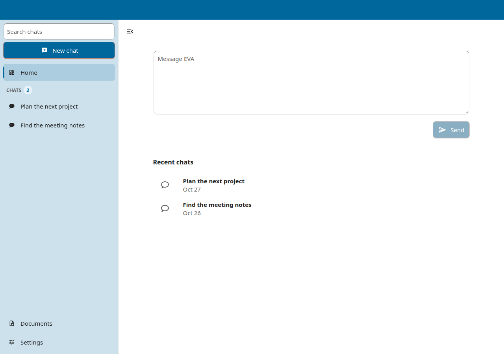
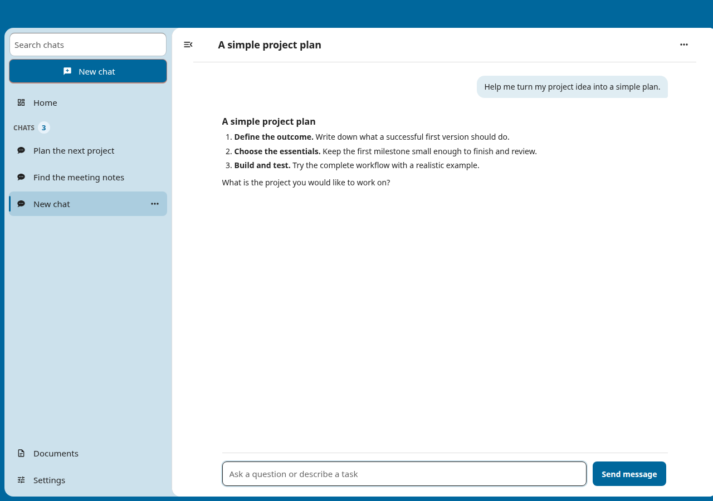
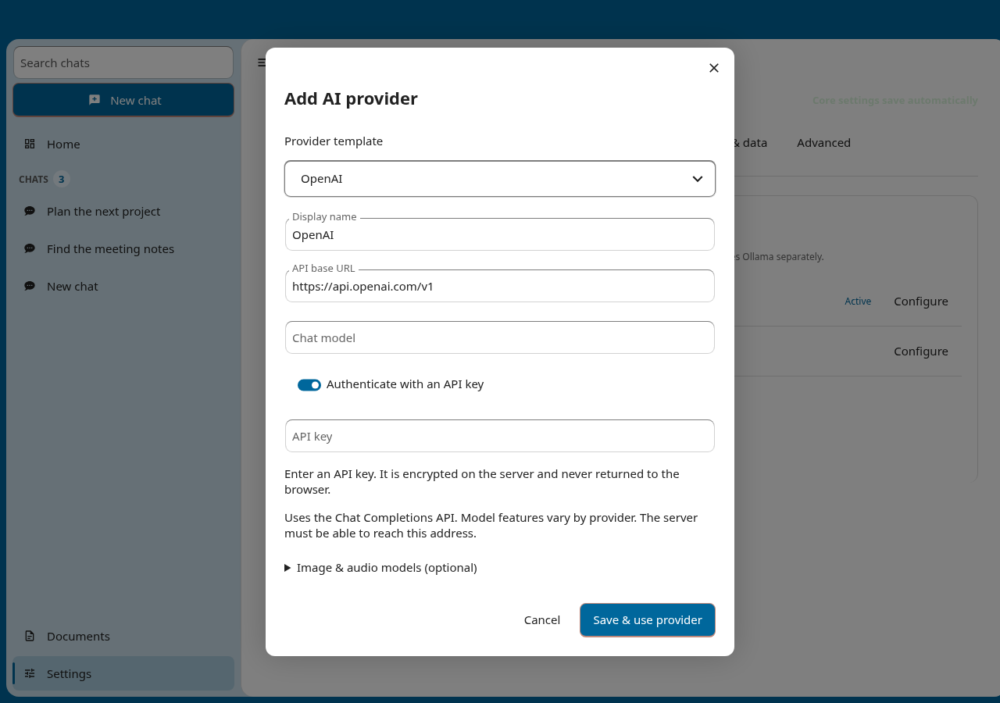

# EVA — Your AI workspace in Nextcloud

Ask questions, find information in your files and work through everyday tasks
without leaving Nextcloud. EVA brings conversations, cited document answers and
optional Nextcloud tools into one workspace.

[](https://github.com/SchBenedikt/nextcloud-ai/actions/workflows/tests.yml)
[](LICENSE)
[](appinfo/info.xml)

[Install EVA](https://apps.nextcloud.com/apps/eva_ai) ·
[Get started](docs/QUICKSTART.md) · [Documentation](docs/README.md) ·
[Report a problem](https://github.com/SchBenedikt/nextcloud-ai/issues)

## Start with a conversation

Home gives you a message input and recent conversations. The chat header stays
compact; exports, reusable prompts and conversation settings live in the native
Nextcloud action menu. Documents and settings each have a clear place in the
navigation.

Settings are grouped into Models, Documents, Tools & permissions, Automation,
Personal & data, and Advanced. Optional integrations load when you open their
section, keeping the everyday path focused.





## Choose your AI provider

Use native Ollama or Groq, or add compatible profiles for OpenAI, Google Gemini,
Mistral, DeepSeek, OpenRouter, Together AI, xAI, LM Studio, vLLM and other servers
implementing Chat Completions. Configure profiles in a form with a name, API
address, model and encrypted key. No JSON editing is needed.

Profiles have separate keys and support multiple configurations of the same
service. Local servers can explicitly disable key authentication. Available
models, tool support and image/audio capabilities depend on the provider.
See the [provider guide](docs/PROVIDERS.md).



Previews show the workspace components with synthetic conversation data in a
test shell using Nextcloud core styles. They do not contain private account data.

Document indexing uses an Ollama embedding model independently of the chat
provider. A locally hosted endpoint can still use a cloud model. Review the
provider and model before assuming inference stays on your own infrastructure.

## Ask about your documents

EVA extracts supported text, PDF, Office, OpenDocument and other file formats,
then combines semantic and keyword retrieval. File answers can link to their
sources so you can verify the response. Optional extraction utilities are
needed for some formats; see [Features](docs/FEATURES.md).

Use Documents to inspect the index and extracted text, or choose **Open with
EVA** from Files for a focused file conversation. Background indexing continues
when you leave the page. Progress checks use a lightweight endpoint without
model discovery or system diagnostics.

## Add tools when you need them

Optional tools integrate with Files, Mail, Calendar, Contacts, Tasks, Talk and
other Nextcloud services. Review permissions and confirmation requests before
approving actions. Web search and external connectors have separate data flows.

Scheduled briefings, usage metrics, background runs, extensions and scoped API
keys remain available through the relevant settings sections. Export chats as
Markdown, text, HTML or DOCX, print to PDF, or create a batch archive. A compatible
provider can also generate images into your EVA folder in Files.

## Install and configure

Install from the [Nextcloud App Store](https://apps.nextcloud.com/apps/eva_ai),
then follow the [quick start](docs/QUICKSTART.md). Supported Nextcloud versions
are declared in [appinfo/info.xml](appinfo/info.xml).

For a source installation, use Node.js from [.nvmrc](.nvmrc), PHP 8.2+ and Composer:

```bash
composer install --no-dev --prefer-dist
npm ci
npm run build
```

Enable the app in Nextcloud and configure working cron before background jobs.
Deploy the complete built `js/` directory: lazy sections need their chunks too.

## Data and privacy

The index is stored on the Nextcloud server. Indexing sends extracted content
to the configured embedding endpoint. Chat sends prompts, relevant excerpts,
conversation context and tool results to the selected provider. Cloud services,
web search and connectors can send information outside your server.

API keys are encrypted separately per user and are never returned by the
profile form. Answers can contain mistakes; check sources and review actions.
Read [Privacy](docs/PRIVACY.md), [Security](docs/SECURITY.md) and
[Configuration](docs/CONFIGURATION.md) before enabling integrations.

## Documentation and development

- [User guide](docs/USER-GUIDE.md) and [workspace settings](docs/WORKSPACE.md).
- [Provider setup](docs/PROVIDERS.md) and [troubleshooting](docs/TROUBLESHOOTING.md).
- [Architecture](docs/ARCHITECTURE.md), [performance](docs/PERFORMANCE.md) and
  [workspace migration](docs/WORKSPACE-MIGRATION.md).
- [API reference](docs/API.md), [plugins](docs/PLUGIN_API.md) and [connectors](docs/CONNECTORS.md).
- [Contributing](CONTRIBUTING.md), [development](docs/DEVELOPMENT.md) and [CI](docs/CI.md).

```bash
composer test
npm test
npm run lint
npm run test:browser
npm run build
```

Frontend changes must include regenerated `js/` output. Submit changes through
pull requests. The standalone chat remains a compatibility and test surface;
the Nextcloud workspace is the primary interface.

Licensed under [AGPL-3.0-or-later](LICENSE).

### A native Nextcloud workspace

The home screen stays focused on a large message field and recent chats using
Nextcloud's own list components. Settings use native sections and sidebar navigation, with
AI providers, document search and advanced integrations kept in separate areas.
See [Workspace settings](docs/WORKSPACE.md) for navigation and saving behavior.
